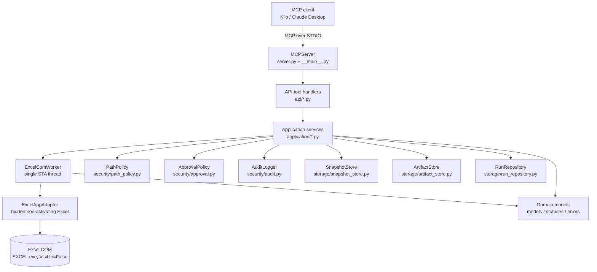
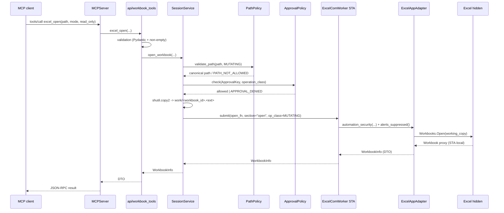

## Purpose

This document explains how `xlvba` works internally: how an MCP client request travels from
JSON-RPC to a hidden Excel instance and back, which layer owns what, how COM access is
serialized, how the Excel process is owned, how the workbook session model works, and how
snapshots, error handling, the mutation guard chain and auditing behave.

This document does not describe individual tools — the complete reference is in
[MCP tools reference](05-mcp-tools-reference.md). Environment-variable settings are in
[Configuration](03-configuration.md), the security model is described in this document,
and limits and incompatibilities are in
[Excel capabilities](06-excel-capabilities.md).

## High-level architecture diagram



The key idea of the diagram: **COM access exists in exactly one place** — on the dedicated
STA thread of `ExcelComWorker`. Every other layer works with typed DTOs and the filesystem.

## Layers

| Layer | Modules | Responsibility | Rule the layer must not violate |
|-------|---------|----------------|---------------------------------|
| Transport | `server.py`, `__main__.py` | Builds `MCPServer`, lifespan, registration of 91 tools and 4 resources, logging to `stderr`, startup via `mcp.run(transport="stdio")`. | Contains no business logic and never touches COM; writes nothing to `stdout` except protocol traffic. |
| API | `api/*.py` | Thin async MCP handlers: argument validation (including tool Pydantic models) and delegation to an application service; returns DTOs. | Performs no business logic, does not import `pythoncom`/`win32com`, never touches COM (ARCH-009). |
| Application | `application/*.py` | Orchestration: workbook session, snapshots, sheets, tables, ranges, PivotTables, names, shapes, controls, VBA, compile, macros, test runner, workbook model. | Owns no COM proxy: every operation is `await worker.submit(...)`; a service builds only an STA-local callable and DTOs. |
| Adapters | `adapters/excel/*`, `adapters/windows_ui/*` | `ExcelComWorker` (single STA thread, queue, recovery), `ExcelAppAdapter` (hidden `Application`), sheet/table/range/pivot/VBIDE/shape/control adapters, `macro_runner`; `VBECompileUI` — read-only VBE command discovery and dialog observation. | COM proxies never leave the STA thread; adapters never change `Visible` and never call `.Activate`/`.Select`/`SendKeys`. |
| Domain | `domain/*` | Models (`models.py`), statuses and enums (`statuses.py`), stable error codes (`errors.py`), declarative test schema (`test_spec.py`). | Does not import `pywin32` and contains no COM; an HRESULT is only an integer. |
| Security | `security/*` | `PathPolicy` (allowlist + canonicalisation), `ApprovalPolicy` (access-mode policy: `full` by default, `restricted` deny-by-default), `AuditLogger` (append-only JSONL, redaction), `macro_policy` (`AutomationSecurity` modes, operation class). | Never bypasses policy: every path goes through `validate_path`, every mutation through an approval gate; audit never writes to `stdout`. |
| Storage | `storage/*` | `SnapshotStore` (immutable snapshots, `manifest.json`, SHA-256), `ArtifactStore` (artifacts and evidence), `RunRepository` (persisted declarative runs), `JobStore` (persisted background jobs + startup reconcile), `OwnedPidStore` (ownership record for startup reconcile). | Filesystem only; no COM. `ArtifactStore` validates its root via `PathPolicy`; `SnapshotStore`, `RunRepository`, `JobStore` and `OwnedPidStore` write only to server-configured runtime directories (paths are server-internal, not caller-supplied). |

Additionally, the `adapters/windows_ui` layer matters for diagnostics: `VBECompileUI.discover_command`
only enumerates `VBE.CommandBars` and performs a read-only `FindControl` probe; it never calls
`CommandBarControl.Execute`. On the validated build no compile command route is available, so
`CompileService` fails closed and returns `indeterminate` (see "Architecture limits").

## MCP transport

- Transport is **MCP over STDIO**. Protocol messages (JSON-RPC) go to `stdout`; diagnostics,
  logs and traces go to `stderr`.
- `_configure_logging()` calls `logging.basicConfig(level=INFO, stream=sys.stderr, ...)` at import
  time. The level is fixed at `INFO`; `EXCEL_VBA_MCP_LOG_LEVEL` is parsed and validated by
  `config.load_config()` (now called in `lifespan` at startup) but is not applied to logging
  (see [Configuration](03-configuration.md)).
- The entry point `excel-vba-mcp` (`__main__.py`) or `python -m excel_vba_mcp` calls
  `mcp.run(transport="stdio")`. There are no CLI flags.
- **Startup is non-fatal when Excel is unavailable.** `lifespan` builds `_Runtime` and tries
  `await worker.start()`; on exception it writes a warning to `stderr`, shuts the worker down
  and **does not publish the services**. The server keeps running: the tool list and
  `server_health` still answer, while workbook tools return a truthful service/session
  unavailability error (`ExcelVbaMcpError` or `WorkerUnavailableError`) instead of a false
  success.
- `server_health` is a read-only liveness probe: it returns `{"status": "ok", "service":
  "excel-vba-mcp", "version": ...}` and **never touches Excel/COM**.
- `excel_health` likewise never touches COM: it reads only the in-memory
  `ExcelComWorker.get_status()` snapshot and session bookkeeping, so it stays truthful while a
  call is "hung" or a session needs recovery.

## Request lifecycle

Let us walk the full path using `excel_open`.

1. The MCP client calls the `excel_open` tool (with a client prefix, e.g. `xlvba_excel_open`)
   and passes the JSON arguments `path`, `mode`, `read_only`.
2. `MCPServer` dispatches the call to the registered handler `api/workbook_tools.excel_open`.
3. **Argument validation.** The handler checks non-empty strings (`_require_non_empty`) and
   coerces `mode` to `SessionMode`; the tool schema (Pydantic) has already validated types and
   allowed values (`mode` is `inspect|execute`).
4. `SessionService.open_workbook` calls `PathPolicy.validate_path(path,
   OperationClass.MUTATING)`. The policy canonicalises the path (`Path.resolve` plus a
   cross-check with `os.path.realpath`) and rejects empty, device, UNC, traversal, symlink and
   "outside roots" paths with `PATH_NOT_ALLOWED`.
5. **Approval gate.** The operation class is determined: `inspect` + `read_only=true` →
   `READ_ONLY` (auto-allowed); `execute` → `EXECUTING`; `inspect` + `read_only=false` →
   `MUTATING`. In the default `full` access mode `ApprovalPolicy.check` authorizes
   `MUTATING`/`EXECUTING` without a grant; in `restricted` mode it allows only `READ_ONLY` or a
   match in the allowlist/grant, and otherwise denies with `ApprovalDeniedError`
   (`APPROVAL_DENIED`).
6. The service checks whether this canonical path is already open (a fast refusal instead of
   waiting forever on the per-path lock that is held).
7. A **working copy** is created: `shutil.copy2(canonical, work/<workbook_id><ext>)`. The
   original is never modified.
8. The service builds the STA-local callable `open_fn` and calls `worker.submit(open_fn,
   timeout=..., section="open", op_class=MUTATING)`.
9. `ExcelComWorker` puts a `_WorkItem` on the FIFO `queue.SimpleQueue`; the STA thread executes
   `open_fn`.
10. Inside `open_fn` the adapter enters narrowly scoped context managers
    `automation_security(...)` and `alerts_suppressed()`, then `ExcelAppAdapter.open_workbook`
    calls `app.Workbooks.Open(...)` on the hidden instance. `AutomationSecurity` is
    `ForceDisable` (3) for `inspect` and `ByUI` (2) immediately before `Open` for `execute`;
    the previous value is restored in `finally`. `DisplayAlerts=False` suppresses only built-in
    Excel warnings, not `MsgBox`, `UserForm.Show`, `FileDialog` or Win32 dialogs.
11. The adapter returns `WorkbookInfo` — a **DTO**, not a COM proxy. The boundary is checked by
    `_ensure_dto`: the return value must be a Pydantic model, a primitive, or a container of
    such values; a COM proxy or any other non-serializable object is rejected and flagged as
    `PROXY_LEAK_SUSPECTED`.
12. The result travels back through `Future` → `SessionService` → the API handler → `MCPServer`
    → a JSON-RPC response to the client.



## Single-threaded COM model

- **One dedicated STA thread.** `ExcelComWorker.start()` creates a `threading.Thread` named
  `excel-com-sta`; the thread calls `pythoncom.CoInitializeEx(COINIT_APARTMENTTHREADED)` once
  and `CoUninitialize` once at the end. No other thread touches COM.
- **FIFO queue.** Every call is a `_WorkItem` on `queue.SimpleQueue` (FIFO, without extra
  locking). The worker is the only consumer.
- **Asynchronous hand-off.** `submit` enqueues the item and awaits
  `asyncio.wrap_future(fut)` under `asyncio.wait_for(timeout=...)`, so the event loop is never
  blocked. The default soft deadline is 60 seconds (macros and the test runner use their own
  values; see [Configuration](03-configuration.md)).
- **DTO boundary.** Tools never touch COM directly. Only DTOs/primitives cross the worker
  boundary, which `_ensure_dto` verifies. COM proxies live only inside the STA thread.
- **Message pump.** The loop uses `queue.get(timeout=0.05)` and calls
  `pythoncom.PumpWaitingMessages()` on idle ticks. Pumping **never** happens inside a running
  `fn` — this prevents re-entering user code.
- **Bounded retry for reads only.** `RPC_E_CALL_REJECTED` for `READ_ONLY` is retried at most 3
  times with 0.5/1.0/2.0-second pauses (pumping between attempts). There are no retries for
  `MUTATING`/`EXECUTING`: a mutation is never blindly re-executed. `RPC_E_SERVERCALL_RETRYLATER`
  maps to `COM_BUSY`; other HRESULTs go through `error_from_hresult` into a typed error.
- **Timeout and recovery.** When the execution deadline is exceeded the worker enters
  `DEADLINE_EXCEEDED` (`running/deadline_exceeded`), records the active token/section and raises a
  truthful `EXCEL_HUNG` (`verdict=SUSPECTED_STALLED`). The already-running call is **not cancelled**
  (a COM call is not interrupted), the owned pid is **not** terminated, and the call is **not
  replayed**; the worker resumes `RUNNING` when it returns. A genuine `NEEDS_RECOVERY` is reserved
  for real recovery (Block A) and is only exited by the hung `fn` returning or an explicit
  `reset()` / `excel_recover`.

## Excel process ownership

- `ExcelAppAdapter.create_hidden()` calls `win32com.client.DispatchEx("Excel.Application")`
  to guarantee a new `EXCEL.exe` process (rather than reusing an instance from the ROT) and
  immediately sets `Visible = False`. If the instance cannot be hidden, it is closed (`Quit`)
  and the error is propagated — a visible instance is not allowed.
- Process identity: `owned_pid` is derived best-effort from `Application.Hwnd` via
  `GetWindowThreadProcessId`; `owned_caption` is read from `Application.Caption`. If `Hwnd` is
  unavailable, `pid` stays `None`, but the instance is still tracked by its proxy reference.
- `Visible=False` is kept for the whole life of the instance; no code path ever sets
  `Visible = True`.
- The adapter never calls `.Activate`, `.Select`, `ShowWindow`, `SetForegroundWindow` or
  `SendKeys`. `DisplayAlerts`/`ScreenUpdating`/`AutomationSecurity` are changed only inside
  context managers that restore the previous value in `finally`.
- `assert_non_intrusive()` is a read-only invariant check: `Visible` must be `False` and the
  instance window must not be foreground. A violation raises `RuntimeError`, which may put the
  worker into `NEEDS_RECOVERY`.
- **Shutdown order** (`shutdown`): stop accepting new work → enqueue a `close` drain plus
  sentinel → process the drain on the STA thread (close all open workbooks with
  `Close(SaveChanges=False)`, `Quit`, release references) → `CoUninitialize` → a bounded
  `thread.join(orphan_timeout_s)` (10 seconds by default). The `close` section runs even in
  `NEEDS_RECOVERY`.
- **`NEEDS_RECOVERY` and `reset()`.** The only ways out of `NEEDS_RECOVERY` are the hung `fn`
  returning or an explicit `reset()`: it runs on the same STA thread, closes and releases the
  current instance, then creates a new one via `create_hidden()`.
  `SessionService.recover_session()` additionally clears the open-workbook bookkeeping and the
  per-path locks; if recovery fails, the state stays `needs_recovery` and new work is refused.
- **Automatic macro recovery (F2b).** `macro_run` is the one path that calls `recover_session`
  itself. When its `Application.Run` dispatch exceeds the soft deadline
  (`macro_timeout_s`, default 90 s, `EXCEL_VBA_MCP_MACRO_TIMEOUT_S`) the service terminates only
  the owned PID and rebuilds the hidden instance in-process (never a server restart), records
  `MacroRunResult.session_recovery` (`"recovered"` / `"needs_recovery"`; `null` when no recovery
  was attempted) and discards open workbooks — the caller's prior `workbook_id` becomes invalid and
  the macro is never auto-replayed. The dispatch itself runs with
  `Application.Interactive=False` / `DisplayAlerts=False` restored in `finally` (F2a,
  defense-in-depth only; not a universal dialog blocker).

### Process lifecycle and job model (Block A/E/F)

The server owns exactly one hidden Excel process for its whole lifetime and never leaks or
double-launches it. Four mechanisms make that guarantee hold across crashes, tree-kills and client
timeouts.

**Single-STA worker.** All COM runs on one dedicated `excel-com-sta` thread created by
`ExcelComWorker.start()` (`CoInitializeEx(COINIT_APARTMENTTHREADED)` once, `CoUninitialize` once).
Every call is a `_WorkItem` on a FIFO `queue.SimpleQueue`; `submit` awaits
`asyncio.wrap_future(fut)` under `asyncio.wait_for`, so the event loop is never blocked. The
per-call timeout is clamped to the server-wide liveness ceiling
(`EXCEL_VBA_MCP_LIVENESS_CEILING_S`, default 600 s). The deadline is split into a **queue-wait**
phase (the item never started → `ComBusyError` / `busy`, worker state unchanged) and an
**execution** phase (the item started but is slow → `DEADLINE_EXCEEDED` + truthful `EXCEL_HUNG`;
the call is not cancelled and the pid is not terminated). `running/deadline_exceeded` is not a
poison state: the worker resumes `running` when the call returns.

**Job Object (kernel backstop).** `ExcelAppAdapter.create_hidden()` creates an **unnamed,
non-inheritable** `JOB_OBJECT_LIMIT_KILL_ON_JOB_CLOSE` job **before** `DispatchEx` and assigns the
owned `EXCEL.exe` into it **right after** the pid is resolved (`AssignProcessToJobObject`, verified
with `IsProcessInJob`). The kernel therefore guarantees the owned Excel dies when the server dies
(tree-kill / crash) with no orphan. Assignment is **fail-closed**: on any failure the just-spawned,
image-verified Excel is terminated and never handed over. The job handle is held as a live
`PyHANDLE` (never reduced to an `int`) and closed only after the verified reap.

**Ownership record + startup reconcile.** A small atomic JSON document
(`owned_pid.json`, `SCHEMA_VERSION=1` additive) records the owner (pid + create-time + exe +
session) and the owned Excel (pid + create-time + exe + session + image-verified) under a stable
per-user directory (`%LOCALAPPDATA%\excel-vba-mcp`, or `EXCEL_VBA_MCP_OWNED_PID_DIR`). A
`state="creating"` marker is written **before** `DispatchEx` to cover the create→assign gap. At
startup the server reconciles precisely:

- **owner alive + identity match** → refuse to launch a second Excel (an operator/agent decision
  is required);
- **owner dead + owned Excel alive + identity verified (pid + create-time + image, same session)**
  → reap exactly that orphan and clear the marker;
- **pid reuse** (create-time mismatch, or the pid is now a non-Excel process) → never kill on
  pid-alone; clear a stale marker and proceed, or refuse when an alive `EXCEL.EXE` cannot be
  identity-verified;
- **cross-session** orphan → refuse (never kill a process in another Windows session).

**In-process JobRegistry + JobStore.** A loop-side, lock-guarded `JobRegistry` **owns the result**
of a long op so a client timeout/disconnect never drops it; it wraps the same single-STA `submit`
(no second STA). A long op returns `{status:"running", job_id, poll_after_s}` promptly; the client
polls `job_get(job_id)`. Lifecycle:
`queued → running → {succeeded | failed | expired | interrupted_unknown}`. When a `JobStore` is
wired, a `RUNNING` marker is written at start and the record is finalized on every terminal state;
after a restart a persisted non-terminal job is reconciled to `interrupted_unknown`
(`outcome="unknown"`, `retryable=false`) — **never** `succeeded`, **never** auto-retried. A
successful `excel_recover` also finalizes in-flight jobs to `interrupted_unknown`. `job_cancel`
records cancel intent only and never interrupts the uninterruptible COM call.

The agent-directed `excel_recover` tool and the `DEADLINE_EXCEEDED` / `SUSPECTED_STALLED` signals
are described in [MCP tools reference](05-mcp-tools-reference.md) and
[Troubleshooting](10-troubleshooting.md); the security class is in [Security](08-security.md).

## Workbook session model

- **Working copy.** `excel_open` copies the source file into the `work/` directory
  (`EXCEL_VBA_MCP_WORK_DIR`, default `<temp>/excel_vba_mcp/work`) and opens **only the copy**.
  No tool ever modifies the original.
- **`mode`.** `execute` (default) applies `ByUI` immediately before `Open`; `inspect` opens the
  workbook with macros disabled (`AutomationSecurity = ForceDisable`). Neither mode changes the
  Trust Center or the registry.
- **`read_only`.** A read-only session opens the working copy read-only; every mutating tool in
  such a session is rejected with `WORKBOOK_READ_ONLY`. The default is `read_only=False`.
- **Explicit saves only.** `excel_close` **does not save** by default (`save_changes=false`).
  Changes are persisted only by an explicit `excel_save` or `excel_close(save_changes=true)`, which
  writes the **working copy**, never the original.
- **Persistence reality.** All edits live only in the working copy under `work/`; the original file
  is never written. Because `excel_close` deletes the working copy and a later `excel_open`
  re-copies the untouched original, "close, then reopen the copy" does **not** show prior edits. To
  persist and later return to an earlier state, use the MCP-native snapshot semantics:
  `snapshot_create` → `excel_close` → `snapshot_restore` (restore reopens a working copy from the
  immutable baseline).
- **Per-path lock.** An `asyncio.Lock` is created for each canonical path and held for the
  entire life of the open workbook, then released on close. Reopening the same file is
  serialized; a duplicate is rejected with an explicit error.
- **Status.** `excel_get_status` returns `SessionStatus`: `session_id`, `workbook_id`,
  `state`, `mode`, `access_mode`, `busy`, `read_only`, `dirty`, `active_operation`, `notes` and
  timestamps. `access_mode` reports the server access policy (`full` or `restricted`).
  The state comes from `WorkbookSessionState` (`starting`, `running`,
  `running/needs_recovery`, `running/deadline_exceeded`, `busy`, `closing`, `closed`, `error`).
- **Bookkeeping without COM.** `excel_get_status`, `excel_list_workbooks` and `excel_health`
  read only in-memory session records and never submit work to the STA thread.

### Working copies & modes (footguns)

- **`excel_open` is writable by default.** The default `mode="execute"`, `read_only=False`
  opens a **writable, execution-capable** session. `mode="inspect"` only disables macros
  (`AutomationSecurity = ForceDisable`); it does **not** imply read-only. A plain
  `excel_open` (no arguments) therefore yields a session that can mutate the working copy and
  run macros — pass `mode="inspect"` **and** `read_only=True` for a strictly read-only session.
  The inspect-is-writable combination (`mode="inspect"`, `read_only=False`) is classified
  `MUTATING`, not `READ_ONLY`.
- **Open performs a double read of the source (double I/O).** `excel_open` first copies the
  original into `work/` with `shutil.copy2`
  (`application/session_service.py`, `_materialize_working_copy`) and then Excel opens that
  copy. The source bytes are thus read twice — once for the file copy and once by Excel — so
  opening a very large workbook incurs roughly double the source I/O. The original is still
  never modified; only the working copy is opened and written.

## Snapshots and rollback

- **Two creation branches.**
  - Open workbook — `Workbook.SaveCopyAs` on the STA worker: a snapshot of the current in-memory
    state into a separate file, without replacing the open workbook
    (`snapshot_method="SaveCopyAs"`). VBA components are additionally exported best-effort
    (`exports/` plus SHA-256).
  - Closed workbook — a plain file copy from the last known source path
    (`snapshot_method="file_copy"`).
- **Atomic store.** The snapshot is assembled in a hidden staging directory and moved into place
  with `os.replace`; `manifest.json` is written through a temporary file plus `os.replace`.
  A snapshot directory either does not exist or is complete — a half-written manifest never
  exists.
- **Manifest and SHA-256.** `manifest.json` contains `snapshot_id`, `created_at`,
  `source_path`, `file_name`, `stored_path`, `sha256`, `size`, `excel_version`,
  `workbook_model`, `vba_exports`, `snapshot_method`, `model_version` and
  `external_side_effects_not_undone: true`. The top-level `sha256` is the
  snapshot **file** hash. Each `vba_exports` entry carries `export_file_sha256`
  (the exported `.bas`/`.cls`/`.frm` **file bytes** hash, plus `frx_sha256` for
  UserForms) — this is **not** the normalized `source_hash`. `model_version` is
  `2` since the F7 rename (`vba_exports[].sha256` → `export_file_sha256`);
  `load`/`list` migrate older v1 manifests in memory.
- **Immutability.** `create` / `finalize_open_branch` never mutate an existing snapshot
  directory; one `snapshot_id` corresponds to exactly one directory.
- **Restore.** `snapshot_restore` closes the current working copy **without saving** (when
  `workbook_id` is supplied) and opens a new working copy from the immutable baseline. The
  snapshot file itself is not modified: the session copies it into `work/`.
- **External effects are not rolled back.** A snapshot restores only the workbook file. Macro
  side effects (database writes, emails, network, files, printing, other workbooks) are **not**
  undone — this is recorded explicitly in the manifest, the audit log and test-runner results.

## Error handling

The base type is `ExcelVbaMcpError` (`domain/errors.py`). It carries:

- `code` — a stable string code from the `ErrorCode` enum;
- `message` — a human-readable message;
- `hresult` — the raw HRESULT (an integer) and `hresult_hex` in the form `0x%08X` when the
  error came from COM;
- `context` — a structured dictionary (path, `workbook_id`, `reason`, `section`, `token`,
  `class`, and so on);
- `to_dict()` — a JSON-serializable representation without COM objects.

`error_from_hresult` maps known HRESULTs to typed subclasses and unknown ones to the base
`ExcelVbaMcpError` with `COM_BUSY` semantics, without losing the HRESULT or the message.

`ErrorCode` codes by group:

| Group | Codes |
|-------|-------|
| Path / approval | `PATH_NOT_ALLOWED`, `WORKBOOK_READ_ONLY`, `APPROVAL_DENIED` |
| VBA / VBOM | `ACCESS_VBOM_DISABLED`, `VBA_PROJECT_LOCKED`, `MISSING_REFERENCE` |
| Compile | `COMPILE_ERROR`, `COMPILE_INDETERMINATE` |
| Macros | `MACRO_BLOCKED`, `MACRO_NOT_FOUND`, `MACRO_RUNTIME_ERROR`, `MACRO_TIMEOUT`, `BACKGROUND_SAFETY_NOT_VERIFIED`, `INTERACTIVE_UI_NOT_SUPPORTED` |
| COM / worker | `COM_BUSY`, `RPC_E_CALL_REJECTED`, `EXCEL_HUNG`, `MODAL_UI_BLOCKED` |
| Caller / concurrency | `WORKBOOK_NOT_FOUND`, `REVISION_CONFLICT`, `NOT_FOUND` |
| Snapshots | `SNAPSHOT_FAILED` |
| Phase 2: ranges and pivots | `INVALID_RANGE`, `PROTECTED_TARGET`, `UNSUPPORTED_PIVOT_SOURCE`, `STALE_TARGET`, `AMBIGUOUS_FILTER`, `REFRESH_FAILED`, `LISTOBJECT_INTERSECTION` |

The `ErrorCode` enum is a stable code contract; not every code must be raised by the current
adapters (for example, `MODAL_UI_BLOCKED` is declared but unused in the current build).
`STALE_TARGET` is emitted by `macro_classify_background` when `expected_project_source_hash` no
longer matches the live source hash. `NOT_FOUND` (additive, F6) is emitted by
`shape_get`/`shape_set_on_action`/`control_get`/`control_set_on_action` when the named object does
not exist, so a caller can distinguish "no such object, do not retry" from the generic `COM_BUSY`
fallback ("Excel busy, retry"). What matters is the stability of the code string, not whether
it is currently emitted.

`BACKGROUND_SAFETY_NOT_VERIFIED` and `INTERACTIVE_UI_NOT_SUPPORTED` are additive `ErrorCode`
members (task_b5) and also appear in `MacroRunResult.error_code` as blocked-run result codes; the
`ErrorCode` enum remains the single source of truth for the literal string values.

**Structured error surfacing over MCP.** The MCP SDK wraps a non-`ToolError` exception a tool
raises into a generic `UnexpectedToolError("Error executing tool <name>")`, which would discard the
domain `code` and `context`. `ExcelVbaMcpServer.call_tool` catches that wrapper, finds the
underlying `ExcelVbaMcpError` in the `__cause__` chain and re-raises a `ToolError` whose message is
the JSON of `to_dict()`, so a real MCP client observes the stable `code` and structured `context`
(for example `APPROVAL_DENIED`, `PATH_NOT_ALLOWED`).

Example of a serialized error:

```json
{
  "code": "PATH_NOT_ALLOWED",
  "message": "The path is not allowed by policy.",
  "hresult": null,
  "hresult_hex": null,
  "context": {
    "reason": "outside_roots",
    "operation": "mutating",
    "path": "D:/data/report.xlsm"
  }
}
```

Diagnostics for specific codes are in [MCP tools reference](05-mcp-tools-reference.md);
a symptom-to-fix table is in [Troubleshooting](10-troubleshooting.md).

## Mutations and the guard chain

Every mutating path follows the same order:

1. **Writable session.** A `read_only` session is rejected with `WORKBOOK_READ_ONLY` before any
   Excel access. Rationale: a read-only open must never be changed accidentally.
2. **Baseline snapshot.** `snapshot_service.require_snapshot(workbook_id)` blocks the mutation
   with `SNAPSHOT_FAILED` when no successful snapshot exists. Rationale: every mutation has a
   rollback point captured before the change.
3. **Approval.** `ApprovalPolicy.check` with the operation class (`MUTATING` or `EXECUTING`).
   In the default `full` access mode the operation is authorized by policy; in `restricted` mode it
   is refused unless an allowlist entry or live grant matches the workbook identity (canonical path
   or SHA-256) and the action. On refusal the services raise `APPROVAL_DENIED` (B4 taxonomy);
   `COM_BUSY`/`RPC_E_CALL_REJECTED` are reserved for genuine COM contention, and `MACRO_BLOCKED`
   only for Office macro-security / non-execute contexts.
4. **Operation-specific checks.** Additional validation before COM: tool Pydantic models
   (`extra="forbid"`), checks such as "payload shape matches the target range", "`shift` is
   explicit", "the `where` filter is unambiguous", "the target does not intersect a
   ListObject", "the PivotTable is not external/OLAP/Data Model". Rationale: invalid input is
   rejected before Excel changes.
5. **Postcondition re-read + audit.** After the mutation the result is re-read from the workbook
   (`postcondition_values`, `result_format`, `PivotFieldInfo`, and so on) and compared with the
   expectation; the `verified` flag reflects the real state, not merely the absence of an
   exception. Every call is written to the audit log with its `operation_class` and result.

Example audit record (abridged):

```json
{
  "schema_version": 1,
  "timestamp": "2026-11-21T18:41:56Z",
  "event_id": "…",
  "correlation_id": "…",
  "session_id": "…",
  "workbook_id": "…",
  "workbook": { "canonical_path": "C:/data/report.xlsm", "sha256": "…" },
  "tool": "range_write_values",
  "operation_class": "mutating",
  "params": { "sheet": "Sheet1", "address": "B2:B4" },
  "approval": { "allowed": true, "reason": "allowed by full-access policy" },
  "snapshot_id": "snap-…",
  "result": { "verified": true },
  "user": "…",
  "process": "excel-vba-mcp",
  "excel_version": "16.0.14332"
}
```

## Audit and security (brief)

- Audit is **append-only JSONL** in `EXCEL_VBA_MCP_AUDIT_LOG`
  (default `<temp>/excel_vba_mcp/audit.jsonl`). One JSON record per line; writes are serialized
  with `threading.Lock`; the file is held open for the logger's lifetime and **never** writes to
  `stdout`, so JSON-RPC is not corrupted.
- **Redaction is mandatory and deliberately "compresses" data**: values under secret-looking
  keys (`password`, `token`, `secret`, `api_key`, `credential`, …) are replaced with
  `"<redacted>"`; paths are reduced to their basename; macro arguments are logged as typed,
  length-bounded summaries without COM references.
- **Path allowlist.** All paths go through `PathPolicy.validate_path`; the root list comes from
  `EXCEL_VBA_MCP_ROOTS` (default CWD plus the system temp), and `allow_unc` is always `False`.
- **Access-mode approval.** `ApprovalPolicy` is constructed with `mode=config.server.access_mode`
  (default `full`) and an empty allowlist, and no grant tool is exposed through MCP. In `full` mode
  `MUTATING`/`EXECUTING` operations are authorized by default and `READ_ONLY` is auto-allowed; in
  `restricted` mode `MUTATING`/`EXECUTING` are refused with `APPROVAL_DENIED`.

Threat model, trust boundaries and the full set of protections are described in this
section above. The complete security and permission model, including the risk table
and the split between implemented controls and operator responsibilities, is in
[Security](08-security.md).

## Architecture limits

- **One Excel instance.** The server owns one hidden, non-activatable instance via `DispatchEx`;
  user Excel processes are never enumerated, activated or terminated.
- **No GUI.** No visible window, no `.Activate`/`.Select`, no `SendKeys`, no interactive
  dialogs. `DisplayAlerts=False` does not block `MsgBox`, `UserForm.Show`, `FileDialog`,
  add-in UI or Win32 dialogs.
- **Compile fails closed.** On the validated build `vba_compile` always returns
  `status=indeterminate` and `reason=NON_ACTIVATING_COMPILE_UNAVAILABLE`; it never reports
  `compiled`/`compile_error` and never shows UI. Partial diagnostics (`is_compile=false`) are
  not a compile.
- **Macros are gated.** `macro_run` requires execute mode, the approval gate, a `background_safe`
  classification for the current workbook hash **and** VBA source revision (BG06) and an
  interactive-UI preflight (R13). `BackgroundSafetyRegistry` starts empty (fail-closed) but is now
  populated through MCP via `macro_classify_background(workbook_id, procedure, background_safe,
  expected_project_source_hash=None)`; the classification is bound to `(workbook_file_sha256,
  project_source_hash, procedure)` and is invalidated when the VBA source changes (an unclassified
  procedure returns `BACKGROUND_SAFETY_NOT_VERIFIED`; a procedure classified unsafe, or one whose
  source hits an interactive token, returns `INTERACTIVE_UI_NOT_SUPPORTED`). In the default `full`
  access mode no per-run approval grant is needed. The R13 token scan is a heuristic veto, never a
  certificate: dynamic `CallByName`/`ExecuteGlobal`/`Eval` indirection and transitive UI are **not**
  fully covered (residual false-safe boundary). The veto list does include window/focus and
  visibility tokens (`AppActivate`, `Application.Visible`, `.Activate`, `WindowState`), so a direct
  use of those is caught — but UI reached only indirectly can still evade a substring scan.
- **Declarative tests are not a sandbox.** A snapshot restores the file, not external effects;
  the action and assertion vocabularies are closed, so arbitrary code cannot be expressed.

The complete list of limits and compatibility constraints is in
[Excel capabilities](06-excel-capabilities.md) and
[Limitations and compatibility](09-limitations-and-compatibility.md).

## Source modules

| Responsibility | File |
|----------------|------|
| Process entry point, STDIO startup | `src/excel_vba_mcp/__main__.py` |
| `MCPServer`, lifespan, tool/resource registration, logging | `src/excel_vba_mcp/server.py` |
| Configuration model (Pydantic) | `src/excel_vba_mcp/config.py` |
| Thin MCP tool handlers | `src/excel_vba_mcp/api/*.py` |
| Workbook session, working copies, save/close, recovery | `src/excel_vba_mcp/application/session_service.py` |
| Snapshots and restore | `src/excel_vba_mcp/application/snapshot_service.py` |
| Sheets, tables, ranges, pivots, names, shapes, controls | `src/excel_vba_mcp/application/{sheets,tables,ranges,pivot_tables,names,shapes,controls}_service.py` |
| VBA project, components, procedures, export, replace/insert | `src/excel_vba_mcp/application/vba_project_service.py` |
| Compilation (fail-closed) | `src/excel_vba_mcp/application/compile_service.py` |
| Macros, `background_safe` registry | `src/excel_vba_mcp/application/macro_service.py` |
| Declarative test runner | `src/excel_vba_mcp/application/test_runner.py` |
| Aggregated workbook model | `src/excel_vba_mcp/application/workbook_model_service.py` |
| Single STA thread, queue, recovery | `src/excel_vba_mcp/adapters/excel/com_worker.py` |
| Hidden `Excel.Application`, `DispatchEx`, Job Object, process identity | `src/excel_vba_mcp/adapters/excel/app_adapter.py` |
| Excel adapters (sheets/tables/ranges/pivots/VBIDE/shapes/controls) | `src/excel_vba_mcp/adapters/excel/*.py` |
| Read-only VBE command discovery and dialog observation | `src/excel_vba_mcp/adapters/windows_ui/vbe_compile_ui.py` |
| Domain models, statuses, errors, test schema | `src/excel_vba_mcp/domain/{models,statuses,errors,test_spec}.py` |
| Path policy | `src/excel_vba_mcp/security/path_policy.py` |
| Approval (access-mode policy: `full` default / `restricted`) | `src/excel_vba_mcp/security/approval.py` |
| Audit (append-only JSONL, redaction) | `src/excel_vba_mcp/security/audit.py` |
| `AutomationSecurity`, operation class | `src/excel_vba_mcp/security/macro_policy.py` |
| Snapshot store | `src/excel_vba_mcp/storage/snapshot_store.py` |
| Artifact store | `src/excel_vba_mcp/storage/artifact_store.py` |
| Declarative run store | `src/excel_vba_mcp/storage/run_repository.py` |
| In-process job registry (owns the result) | `src/excel_vba_mcp/application/job_registry.py` |
| Persisted job store (RUNNING marker + startup reconcile) | `src/excel_vba_mcp/storage/job_store.py` |
| Ownership record (pid + create-time + exe + session) | `src/excel_vba_mcp/storage/owned_pid_store.py` |