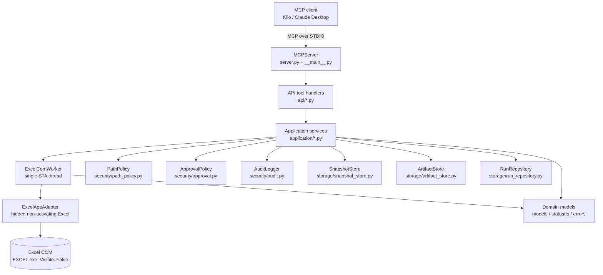
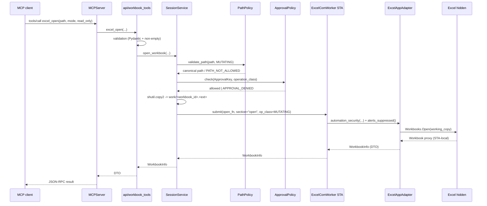

## Назначение

Документ объясняет, как `xlvba` устроен внутренне: как запрос MCP-клиента проходит путь от
JSON-RPC до скрытого экземпляра Excel и обратно, какие слои за что отвечают, как
сериализован доступ к COM, как устроено владение процессом Excel, модель сессии книги,
снапшоты, обработка ошибок, цепочка защит при мутациях и аудит.

Документ не описывает отдельные инструменты — их полный справочник находится в
[Справочник инструментов MCP](05-mcp-tools-reference.md). Настройки переменных окружения —
в [Конфигурация](03-configuration.md), модель безопасности — в
[Безопасность](08-security.md), пределы и несовместимости — в
[Ограничения и совместимость](09-limitations-and-compatibility.md).

## Краткая architectural-схема



Ключевая идея схемы: **COM-доступ существует только в одной точке** — на выделенном STA-потоке
`ExcelComWorker`. Все остальные слои работают с типизированными DTO и файловой системой.

## Слои

| Слой | Модули | Ответственность | Правило, которое слой не должен нарушать |
|------|--------|-----------------|------------------------------------------|
| Transport | `server.py`, `__main__.py` | Сборка `MCPServer`, lifespan, регистрация 88 инструментов и 4 ресурсов, логирование в `stderr`, запуск `mcp.run(transport="stdio")`. | Не содержит бизнес-логики и не обращается к COM; не пишет в `stdout` ничего, кроме протокола. |
| API | `api/*.py` | Тонкие async-хендлеры MCP: валидация аргументов (в том числе Pydantic-моделями инструментов) и делегирование в application-сервис; возвращают DTO. | Не выполняет бизнес-логику, не импортирует `pythoncom`/`win32com`, не трогает COM (ARCH-009). |
| Application | `application/*.py` | Оркестрация: сессия книги, снапшоты, листы, таблицы, диапазоны, сводные таблицы, имена, фигуры, элементы управления, VBA, компиляция, макросы, тестовый раннер, модель книги. | Не владеет COM-прокси: каждая операция — это `await worker.submit(...)`; сервис строит только STA-local callable и DTO. |
| Adapters | `adapters/excel/*`, `adapters/windows_ui/*` | `ExcelComWorker` (единый STA-поток, очередь, recovery), `ExcelAppAdapter` (скрытый `Application`), адаптеры листов/таблиц/диапазонов/сводных/VBIDE/фигур/элементов, `macro_runner`; `VBECompileUI` — read-only исследование команд VBE и наблюдение диалогов. | COM-прокси не покидает STA-поток; адаптеры не меняют `Visible`, не вызывают `.Activate`/`.Select`/`SendKeys`. |
| Domain | `domain/*` | Модели (`models.py`), статусы и перечисления (`statuses.py`), стабильные коды ошибок (`errors.py`), схема декларативных тестов (`test_spec.py`). | Не импортирует `pywin32` и не содержит COM; HRESULT — только целое число. |
| Security | `security/*` | `PathPolicy` (allowlist + канонизация), `ApprovalPolicy` (политика доступа: `full` по умолчанию, `restricted` deny-by-default), `AuditLogger` (append-only JSONL, redaction), `macro_policy` (режимы `AutomationSecurity`, класс операции). | Не обходит политику: любой путь проходит `validate_path`, любая мутация — approval-гейт; аудит не пишет в `stdout`. |
| Storage | `storage/*` | `SnapshotStore` (иммутабельные снапшоты, `manifest.json`, SHA-256), `ArtifactStore` (артефакты и доказательства), `RunRepository` (сохранённые декларативные прогоны). | Только файловая система; никакого COM и никакой записи за пределами разрешённых корней. |

Дополнительно слой `adapters/windows_ui` важен для диагностики: `VBECompileUI.discover_command`
только перечисляет `VBE.CommandBars` и read-only пробует `FindControl`, никогда не вызывает
`CommandBarControl.Execute`. На валидированной сборке маршрут компиляции недоступен, поэтому
`CompileService` fail-closed возвращает `indeterminate` (см. раздел «Ограничения архитектуры»).

## Транспорт MCP

- Транспорт — **MCP поверх STDIO**. Сообщения протокола (JSON-RPC) идут в `stdout`;
  диагностика, логи и трассировки — в `stderr`.
- `_configure_logging()` вызывает `logging.basicConfig(level=INFO, stream=sys.stderr, ...)` при
  импорте модуля. Уровень фиксирован на `INFO`; переменная `EXCEL_VBA_MCP_LOG_LEVEL` разбирается
  и валидируется в `config.load_config()` (теперь вызывается в `lifespan` при старте), но не
  применяется к логированию (подробнее — [Конфигурация](03-configuration.md)).
- Точка входа `excel-vba-mcp` (`__main__.py`) или `python -m excel_vba_mcp` вызывает
  `mcp.run(transport="stdio")`. CLI-флагов нет.
- **Старт не фатален, если Excel недоступен.** `lifespan` строит `_Runtime`, пытается
  `await worker.start()`; при исключении пишет предупреждение в `stderr`, останавливает
  воркер и **не публикует сервисы**. Сервер продолжает работать: список инструментов и
  `server_health` отвечают, а инструменты работы с книгами возвращают правдивую ошибку
  недоступности сервиса/сессии (`ExcelVbaMcpError` или `WorkerUnavailableError`), а не
  «ложный успех».
- `server_health` — read-only liveness-проба: возвращает `{"status": "ok", "service":
  "excel-vba-mcp", "version": ...}` и **никогда не обращается к Excel/COM**.
- `excel_health` также не обращается к COM: он читает только in-memory снимок
  `ExcelComWorker.get_status()` и bookkeeping сессии, поэтому остаётся правдивым, пока вызов
  «висит» или сессия требует восстановления.

## Жизненный цикл запроса

Разберём полный путь на примере `excel_open`.

1. MCP-клиент вызывает инструмент `excel_open` (в клиенте — с префиксом, например
   `xlvba_excel_open`) и передаёт JSON-аргументы `path`, `mode`, `read_only`.
2. `MCPServer` сопоставляет вызов зарегистрированному обработчику `api/workbook_tools.excel_open`.
3. **Валидация аргументов.** Хендлер проверяет непустые строки (`_require_non_empty`) и
   приводит `mode` к `SessionMode`; схема инструмента (Pydantic) уже проверила типы и
   допустимые значения (`mode` — `inspect|execute`).
4. `SessionService.open_workbook` вызывает `PathPolicy.validate_path(path,
   OperationClass.MUTATING)`. Политика канонизирует путь (`Path.resolve` + перекрёстная
   проверка `os.path.realpath`) и отклоняет пустые, device-, UNC-, traversal-, symlink- и
   «вне корней» пути с кодом `PATH_NOT_ALLOWED`.
5. **Approval-гейт.** Определяется класс операции: `inspect` + `read_only=true` →
   `READ_ONLY` (auto-allowed); `execute` → `EXECUTING`; `inspect` + `read_only=false` →
   `MUTATING`. В режиме `full` (по умолчанию) `ApprovalPolicy.check` авторизует
   `MUTATING`/`EXECUTING` без гранта; в режиме `restricted` разрешает только `READ_ONLY`
   либо совпадение с allowlist/грантом, иначе — `ApprovalDeniedError` (`APPROVAL_DENIED`).
6. Проверяется, не открыт ли этот canonical path уже (быстрый отказ вместо вечного ожидания
   на удерживаемом per-path lock).
7. Создаётся **рабочая копия**: `shutil.copy2(canonical, work/<workbook_id><ext>)`. Оригинал
   не изменяется никогда.
8. Сервис строит STA-local callable `open_fn` и вызывает `worker.submit(open_fn,
   timeout=..., section="open", op_class=MUTATING)`.
9. `ExcelComWorker` кладёт `_WorkItem` в FIFO-очередь `queue.SimpleQueue`; STA-поток
   исполняет `open_fn`.
10. Внутри `open_fn` адаптер входит в узко ограниченные контекстные менеджеры
    `automation_security(...)` и `alerts_suppressed()`, затем `ExcelAppAdapter.open_workbook`
    вызывает `app.Workbooks.Open(...)` на скрытом экземпляре. `AutomationSecurity`
    = `ForceDisable` (3) для `inspect` и `ByUI` (2) непосредственно перед `Open` для
    `execute`; прежнее значение восстанавливается в `finally`. `DisplayAlerts=False`
    подавляет только встроенные предупреждения Excel, но не `MsgBox`, `UserForm.Show`,
    `FileDialog` и Win32-диалоги.
11. Адаптер возвращает `WorkbookInfo` — **DTO**, а не COM-прокси. Границу проверяет
    `_ensure_dto`: возврат должен быть Pydantic-моделью, примитивом или контейнером таких
    значений; COM-прокси или иной несериализуемый объект отклоняется с пометкой
    `PROXY_LEAK_SUSPECTED`.
12. Результат идёт обратно через `Future` → `SessionService` → API-хендлер → `MCPServer` →
    JSON-RPC-ответ клиенту.



## Однопоточная модель COM

- **Один выделенный STA-поток.** `ExcelComWorker.start()` создаёт `threading.Thread`
  с именем `excel-com-sta`, поток один раз вызывает
  `pythoncom.CoInitializeEx(COINIT_APARTMENTTHREADED)` и один раз в конце —
  `CoUninitialize`. Никакой другой поток не обращается к COM.
- **FIFO-очередь.** Каждый вызов — `_WorkItem` в `queue.SimpleQueue` (FIFO, без лишних
  блокировок). Воркер — единственный потребитель.
- **Асинхронная передача.** `submit` кладёт элемент и ожидает `asyncio.wrap_future(fut)`
  под `asyncio.wait_for(timeout=...)`, поэтому цикл событий никогда не блокируется.
  Мягкий дедлайн по умолчанию — 60 секунд (для макросов и тестового раннера — свои
  значения; см. [Конфигурация](03-configuration.md)).
- **Граница DTO.** Инструменты никогда не трогают COM напрямую. Через границу воркера
  проходят только DTO/примитивы, что проверяет `_ensure_dto`. COM-прокси живёт только
  внутри STA-потока.
- **Message pump.** Цикл использует `queue.get(timeout=0.05)` и на холостом такте вызывает
  `pythoncom.PumpWaitingMessages()`. Пампинг **никогда** не выполняется внутри работающего
  `fn` — это предотвращает повторный вход в пользовательский код.
- **Ограниченный retry только для чтения.** `RPC_E_CALL_REJECTED` для `READ_ONLY`
  повторяется не более 3 раз с паузами 0.5/1.0/2.0 секунды (с пампингом между попытками).
  Для `MUTATING`/`EXECUTING` повторов нет: мутация никогда не переисполняется вслепую.
  `RPC_E_SERVERCALL_RETRYLATER` сопоставляется с `COM_BUSY`; прочие HRESULT — через
  `error_from_hresult` в типизированную ошибку.
- **Таймаут и восстановление.** При превышении дедлайна воркер переходит в
  `NEEDS_RECOVERY`, записывает активный токен/секцию и поднимает правдивый `EXCEL_HUNG`.
  Уже запущенный вызов **не отменяется** (COM-вызов не прерываем) и **не переигрывается**.

## Владение процессом Excel

- `ExcelAppAdapter.create_hidden()` вызывает `win32com.client.DispatchEx("Excel.Application")`,
  чтобы гарантированно создать новый процесс `EXCEL.exe` (а не переиспользовать
  экземпляр из ROT), и немедленно устанавливает `Visible = False`. Если скрыть экземпляр не
  удалось, он закрывается (`Quit`) и ошибка пробрасывается — видимый экземпляр недопустим.
- Идентичность процесса: `owned_pid` best-effort выводится из `Application.Hwnd` через
  `GetWindowThreadProcessId`; `owned_caption` читается из `Application.Caption`. Если
  `Hwnd` недоступен, `pid` остаётся `None`, но экземпляр всё равно отслеживается по
  proxy-ссылке.
- `Visible=False` сохраняется всю жизнь экземпляра; код не содержит ни одного пути,
  который бы выставлял `Visible = True`.
- Адаптер не вызывает `.Activate`, `.Select`, `ShowWindow`, `SetForegroundWindow`,
  `SendKeys`. `DisplayAlerts`/`ScreenUpdating`/`AutomationSecurity` меняются только внутри
  контекстных менеджеров, восстанавливающих прежнее значение в `finally`.
- `assert_non_intrusive()` — read-only проверка инварианта: `Visible` должен быть `False`,
  а окно экземпляра не должно быть foreground. Нарушение даёт `RuntimeError`, по которому
  воркер может войти в `NEEDS_RECOVERY`.
- **Порядок завершения** (`shutdown`): остановить приём новой работы → поставить
  `close`-drain + sentinel → обработать дренаж на STA-потоке (закрыть все открытые книги с
  `Close(SaveChanges=False)`, `Quit`, освободить ссылки) → `CoUninitialize` →
  ограниченный `thread.join(orphan_timeout_s)` (по умолчанию 10 секунд). Секция `close`
  проходит даже в состоянии `NEEDS_RECOVERY`.
- **`NEEDS_RECOVERY` и `reset()`.** Единственные выходы из `NEEDS_RECOVERY` — возврат
  зависшего `fn` либо явный `reset()`: он выполняется на том же STA-потоке, закрывает и
  освобождает текущий экземпляр, затем создаёт новый `create_hidden()`.
  `SessionService.recover_session()` дополнительно сбрасывает bookkeeping открытых книг и
  per-path блокировки; если восстановление не удалось, состояние остаётся
  `needs_recovery`, и новая работа отклоняется.

## Модель сессии книги

- **Рабочая копия.** `excel_open` копирует исходный файл в каталог `work/`
  (`EXCEL_VBA_MCP_WORK_DIR`, по умолчанию `<temp>/excel_vba_mcp/work`) и открывает
  **только копию**. Оригинал не изменяется ни одним инструментом.
- **`mode`.** `execute` (по умолчанию) применяет `ByUI` непосредственно перед `Open`; `inspect`
  открывает книгу с отключёнными макросами (`AutomationSecurity = ForceDisable`). Ни один режим не
  меняет Trust Center или реестр.
- **`read_only`.** Read-only-сессия открывает рабочую копию только для чтения; все
  мутирующие инструменты в такой сессии отклоняются с `WORKBOOK_READ_ONLY`. По умолчанию
  `read_only=False`.
- **Явные сохранения.** `excel_close` по умолчанию **не сохраняет** (`save_changes=false`).
  Изменения сохраняются только явным `excel_save` или `excel_close(save_changes=true)`, которые
  записывают **рабочую копию**, а не оригинал.
- **Реальность персистентности.** Все правки живут только в рабочей копии в `work/`; оригинал
  никогда не записывается. Поскольку `excel_close` удаляет рабочую копию, а повторный `excel_open`
  копирует нетронутый оригинал, «закрыть, затем открыть копию» **не** показывает прежние правки.
  Чтобы сохранить и вернуться к прежнему состоянию, используйте семантику снапшотов:
  `snapshot_create` → `excel_close` → `snapshot_restore`.
- **Блокировка на путь.** На каждый canonical path создаётся `asyncio.Lock`, который
  удерживается всё время жизни открытой книги и освобождается при закрытии. Повторное
  открытие того же файла сериализуется; дубликат отклоняется с явной ошибкой.
- **Статус.** `excel_get_status` отдаёт `SessionStatus`: `session_id`, `workbook_id`,
  `state`, `mode`, `access_mode`, `busy`, `read_only`, `dirty`, `active_operation`, `notes`,
  временные метки. `access_mode` сообщает политику доступа (`full` или `restricted`).
  Состояние — из `WorkbookSessionState` (`starting`, `running`,
  `running/needs_recovery`, `busy`, `closing`, `closed`, `error`).
- **Bookkeeping без COM.** `excel_get_status`, `excel_list_workbooks`, `excel_health`
  читают только in-memory записи сессии и не отправляют работу в STA-поток.

## Снапшоты и откат

- **Две ветви создания.**
  - Открытая книга — `Workbook.SaveCopyAs` на STA-воркере: снимок текущего состояния в
    памяти в отдельный файл, без замены открытой книги (`snapshot_method="SaveCopyAs"`).
    Дополнительно best-effort экспортируются VBA-компоненты (`exports/` + SHA-256).
  - Закрытая книга — обычное копирование файла с последнего известного source path
    (`snapshot_method="file_copy"`).
- **Атомарное хранилище.** Снапшот собирается в скрытом staging-каталоге и переносится на
  место через `os.replace`; `manifest.json` пишется через временный файл + `os.replace`.
  Каталог снапшота либо отсутствует, либо полон — полузаписанного манифеста не бывает.
- **Манифест и SHA-256.** `manifest.json` содержит `snapshot_id`, `created_at`,
  `source_path`, `file_name`, `stored_path`, `sha256`, `size`, `excel_version`,
  `workbook_model`, `vba_exports`, `snapshot_method`, `model_version` и
  `external_side_effects_not_undone: true`.
- **Иммутабельность.** `create` / `finalize_open_branch` никогда не изменяют существующий
  каталог снапшота; один `snapshot_id` соответствует ровно одному каталогу.
- **Восстановление.** `snapshot_restore` закрывает текущую рабочую копию **без
  сохранения** (если передан `workbook_id`) и открывает новую рабочую копию из
  иммутабельного baseline. Сам файл снапшота не изменяется: сессия копирует его в `work/`.
- **Внешние эффекты не откатываются.** Снапшот восстанавливает только файл книги.
  Побочные эффекты макросов (запись в БД, письма, сеть, файлы, печать, другие книги) **не**
  отменяются — это явно зафиксировано в манифесте, аудите и результатах тестового раннера.

## Обработка ошибок

Базовый тип — `ExcelVbaMcpError` (`domain/errors.py`). Он несёт:

- `code` — стабильный строковый код из перечисления `ErrorCode`;
- `message` — человекочитаемое сообщение;
- `hresult` — сырой HRESULT (целое число) и `hresult_hex` в форме `0x%08X`, когда ошибка
  пришла из COM;
- `context` — структурированный словарь (путь, `workbook_id`, `reason`, `section`,
  `token`, `class` и т. п.);
- `to_dict()` — JSON-сериализуемое представление без COM-объектов.

`error_from_hresult` сопоставляет известные HRESULT типизированным подклассам, а
неизвестные — базовому `ExcelVbaMcpError` с семантикой `COM_BUSY`, не теряя HRESULT и
сообщение.

Коды `ErrorCode` по группам:

| Группа | Коды |
|--------|------|
| Путь / approval | `PATH_NOT_ALLOWED`, `WORKBOOK_READ_ONLY`, `APPROVAL_DENIED` |
| VBA / VBOM | `ACCESS_VBOM_DISABLED`, `VBA_PROJECT_LOCKED`, `MISSING_REFERENCE` |
| Компиляция | `COMPILE_ERROR`, `COMPILE_INDETERMINATE` |
| Макросы | `MACRO_BLOCKED`, `MACRO_NOT_FOUND`, `MACRO_RUNTIME_ERROR`, `MACRO_TIMEOUT`, `BACKGROUND_SAFETY_NOT_VERIFIED`, `INTERACTIVE_UI_NOT_SUPPORTED` |
| COM / worker | `COM_BUSY`, `RPC_E_CALL_REJECTED`, `EXCEL_HUNG`, `MODAL_UI_BLOCKED` |
| Снапшоты | `SNAPSHOT_FAILED` |
| Phase 2: диапазоны и сводные | `INVALID_RANGE`, `PROTECTED_TARGET`, `UNSUPPORTED_PIVOT_SOURCE`, `STALE_TARGET`, `AMBIGUOUS_FILTER`, `REFRESH_FAILED`, `LISTOBJECT_INTERSECTION` |

Перечисление `ErrorCode` — это стабильный контракт кодов; не каждый код обязан
подниматься текущими адаптерами (например, `MODAL_UI_BLOCKED` объявлен, но в текущей
сборке не используется). `STALE_TARGET` поднимается `macro_classify_background`, когда
`expected_project_source_hash` больше не совпадает с живым хэшем исходников. Значение имеет
стабильность строки кода, а не факт его текущей эмиссии.

`BACKGROUND_SAFETY_NOT_VERIFIED` и `INTERACTIVE_UI_NOT_SUPPORTED` — аддитивные члены
`ErrorCode` (task_b5), которые также появляются в `MacroRunResult.error_code` как коды
заблокированного прогона; перечисление `ErrorCode` остаётся единственным источником истины
для строковых значений.

**Структурированная передача ошибок через MCP.** MCP SDK оборачивает не-`ToolError` исключение
инструмента в общее `UnexpectedToolError("Error executing tool <name>")`, что потеряло бы
доменные `code` и `context`. `ExcelVbaMcpServer.call_tool` перехватывает эту обёртку, находит
`ExcelVbaMcpError` в цепочке `__cause__` и поднимает `ToolError`, сообщение которого — JSON
`to_dict()`, поэтому реальный MCP-клиент видит стабильный `code` и структурированный `context`
(например, `APPROVAL_DENIED`, `PATH_NOT_ALLOWED`).

Пример сериализованной ошибки:

```json
{
  "code": "PATH_NOT_ALLOWED",
  "message": "The path is not allowed by policy.",
  "hresult": null,
  "hresult_hex": null,
  "context": {
    "reason": "outside_roots",
    "operation": "mutating",
    "path": "D:/data/report.xlsm"
  }
}
```

Диагностика по конкретным кодам — в [Устранение неполадок](10-troubleshooting.md).

## Мутации и цепочка защит (guard chain)

Каждый мутирующий путь строится в одном и том же порядке:

1. **Writable session.** `read_only`-сессия отклоняется с `WORKBOOK_READ_ONLY` до любого
   обращения к Excel. Смысл: read-only открытие не может быть случайно изменено.
2. **Baseline snapshot.** `snapshot_service.require_snapshot(workbook_id)` блокирует
   мутацию с `SNAPSHOT_FAILED`, если успешного снапшота нет. Смысл: у любой мутации есть
   точка отката, зафиксированная до изменения.
3. **Approval.** `ApprovalPolicy.check` с классом операции (`MUTATING` или `EXECUTING`).
   В режиме `full` (по умолчанию) операция авторизована политикой; в режиме `restricted` она
   отклоняется, если нет записи allowlist или живого гранта, привязанных к идентичности книги
   (canonical path или SHA-256) и действию. При отказе сервисы поднимают `APPROVAL_DENIED`
   (таксономия B4); `COM_BUSY`/`RPC_E_CALL_REJECTED` зарезервированы для реальной конкуренции за
   COM, а `MACRO_BLOCKED` — только для Office macro-security / не-execute контекстов.
4. **Operation-specific checks.** Дополнительная валидация до COM: Pydantic-модели
   инструментов (`extra="forbid"`), проверки вида «payload совпадает по размеру с
   целевым диапазоном», «`shift` задан явно», «`where`-фильтр однозначен», «цель не
   пересекает ListObject», «сводная таблица не является external/OLAP/Data Model».
   Смысл: невалидный ввод отклоняется до того, как Excel изменится.
5. **Postcondition re-read + audit.** После мутации результат перечитывается из книги
   (`postcondition_values`, `result_format`, `PivotFieldInfo` и т. п.) и сравнивается с
   ожиданием; флаг `verified` отражает реальное состояние, а не факт отсутствия
   исключения. Каждый вызов записывается в аудит с `operation_class` и результатом.

Пример аудиторской записи (сокращённо):

```json
{
  "schema_version": 1,
  "timestamp": "2026-11-21T18:41:56Z",
  "event_id": "…",
  "correlation_id": "…",
  "session_id": "…",
  "workbook_id": "…",
  "workbook": { "canonical_path": "C:/data/report.xlsm", "sha256": "…" },
  "tool": "range_write_values",
  "operation_class": "mutating",
  "params": { "sheet": "Sheet1", "address": "B2:B4" },
  "approval": { "allowed": true, "reason": "allowed by full-access policy" },
  "snapshot_id": "snap-…",
  "result": { "verified": true },
  "user": "…",
  "process": "excel-vba-mcp",
  "excel_version": "16.0.14332"
}
```

## Аудит и безопасность (кратко)

- Аудит — **append-only JSONL** в `EXCEL_VBA_MCP_AUDIT_LOG`
  (по умолчанию `<temp>/excel_vba_mcp/audit.jsonl`). Одна JSON-запись на строку,
  запись сериализована `threading.Lock`, файл открыт отдельным handle и **никогда** не
  пишет в `stdout`, чтобы не повредить JSON-RPC.
- **Redaction обязателен и намеренно «сжимает» данные**: значения по «секретным» ключам
  (`password`, `token`, `secret`, `api_key`, `credential`, …) заменяются на
  `"<redacted>"`; пути сводятся к basename; аргументы макросов логируются как
  типизированные и ограниченные по длине сводки без COM-ссылок.
- **Path allowlist.** Все пути проходят `PathPolicy.validate_path`; список корней задаётся
  `EXCEL_VBA_MCP_ROOTS` (по умолчанию CWD + системный temp), `allow_unc` всегда `False`.
- **Approval по режиму доступа.** `ApprovalPolicy` создаётся с `mode=config.server.access_mode`
  (по умолчанию `full`) и пустым allowlist; grant-инструмент через MCP не предоставляется. В
  режиме `full` `MUTATING`/`EXECUTING` авторизованы по умолчанию, а `READ_ONLY` разрешена
  автоматически; в режиме `restricted` `MUTATING`/`EXECUTING` отклоняются с `APPROVAL_DENIED`.

Модель угроз, границы доверия и полный перечень защит — в
[Безопасность](08-security.md).

## Ограничения архитектуры

- **Один экземпляр Excel.** Сервер владеет одним скрытым, неактивируемым экземпляром через
  `DispatchEx`; пользовательские процессы Excel не перечисляются, не активируются и не
  завершаются.
- **Нет GUI.** Нет видимого окна, нет `.Activate`/`.Select`, нет `SendKeys`, нет
  интерактивных диалогов. `DisplayAlerts=False` не блокирует `MsgBox`, `UserForm.Show`,
  `FileDialog`, UI надстроек и Win32-диалоги.
- **Компиляция fail-closed.** `vba_compile` на валидированной сборке всегда возвращает
  `status=indeterminate` и `reason=NON_ACTIVATING_COMPILE_UNAVAILABLE`; он никогда не
  сообщает `compiled`/`compile_error` и не показывает UI. Частичные диагностические данные
  (`is_compile=false`) — это не компиляция.
- **Макросы под гейтом.** `macro_run` требует execute-режима, approval-гейта, классификации
  `background_safe` для текущего хэша книги **и** ревизии исходников VBA (BG06) и прохождения
  preflight интерактивного UI (R13). Реестр `BackgroundSafetyRegistry` стартует пустым
  (fail-closed), но теперь заполняется через MCP инструментом `macro_classify_background(workbook_id,
  procedure, background_safe, expected_project_source_hash=None)`; классификация привязана к
  `(workbook_file_sha256, project_source_hash, procedure)` и инвалидируется при изменении
  исходников VBA (неклассифицированная процедура возвращает `BACKGROUND_SAFETY_NOT_VERIFIED`;
  процедура, помеченная как unsafe, или с интерактивным токеном — `INTERACTIVE_UI_NOT_SUPPORTED`).
  В режиме `full` (по умолчанию) отдельный грант на запуск не нужен. Токен-скан R13 — эвристический
  запрет, а не доказательство: динамическая индирекция `CallByName`/`ExecuteGlobal`/`Eval`,
  транзитивный UI и токены `AppActivate`/`Application.Visible = True` полностью не покрываются
  (остаточная граница ложно-безопасного).
- **Декларативные тесты не являются песочницей.** Снапшот восстанавливает файл, но не
  внешние эффекты; набор действий и проверок закрыт, произвольный код выразить нельзя.

Полный перечень ограничений и совместимости — в
[Ограничения и совместимость](09-limitations-and-compatibility.md).

## Исходные модули

| Ответственность | Файл |
|-----------------|------|
| Точка входа процесса, запуск STDIO | `src/excel_vba_mcp/__main__.py` |
| `MCPServer`, lifespan, регистрация инструментов/ресурсов, логирование | `src/excel_vba_mcp/server.py` |
| Модель конфигурации (Pydantic) | `src/excel_vba_mcp/config.py` |
| Тонкие MCP-хендлеры инструментов | `src/excel_vba_mcp/api/*.py` |
| Сессия книги, рабочие копии, save/close, recovery | `src/excel_vba_mcp/application/session_service.py` |
| Снапшоты и restore | `src/excel_vba_mcp/application/snapshot_service.py` |
| Листы, таблицы, диапазоны, сводные, имена, фигуры, элементы | `src/excel_vba_mcp/application/{sheets,tables,ranges,pivot_tables,names,shapes,controls}_service.py` |
| VBA-проект, компоненты, процедуры, экспорт, замена/вставка | `src/excel_vba_mcp/application/vba_project_service.py` |
| Компиляция (fail-closed) | `src/excel_vba_mcp/application/compile_service.py` |
| Макросы, реестр `background_safe` | `src/excel_vba_mcp/application/macro_service.py` |
| Декларативный тестовый раннер | `src/excel_vba_mcp/application/test_runner.py` |
| Агрегированная модель книги | `src/excel_vba_mcp/application/workbook_model_service.py` |
| Единый STA-поток, очередь, recovery | `src/excel_vba_mcp/adapters/excel/com_worker.py` |
| Скрытый `Excel.Application`, `DispatchEx` | `src/excel_vba_mcp/adapters/excel/app_adapter.py` |
| Адаптеры Excel (листы/таблицы/диапазоны/сводные/VBIDE/фигуры/элементы) | `src/excel_vba_mcp/adapters/excel/*.py` |
| Read-only исследование VBE-команд и наблюдение диалогов | `src/excel_vba_mcp/adapters/windows_ui/vbe_compile_ui.py` |
| Доменные модели, статусы, ошибки, схема тестов | `src/excel_vba_mcp/domain/{models,statuses,errors,test_spec}.py` |
| Политика путей | `src/excel_vba_mcp/security/path_policy.py` |
| Approval (политика доступа: `full` по умолчанию / `restricted`) | `src/excel_vba_mcp/security/approval.py` |
| Аудит (append-only JSONL, redaction) | `src/excel_vba_mcp/security/audit.py` |
| `AutomationSecurity`, класс операции | `src/excel_vba_mcp/security/macro_policy.py` |
| Хранилище снапшотов | `src/excel_vba_mcp/storage/snapshot_store.py` |
| Хранилище артефактов | `src/excel_vba_mcp/storage/artifact_store.py` |
| Хранилище декларативных прогонов | `src/excel_vba_mcp/storage/run_repository.py` |